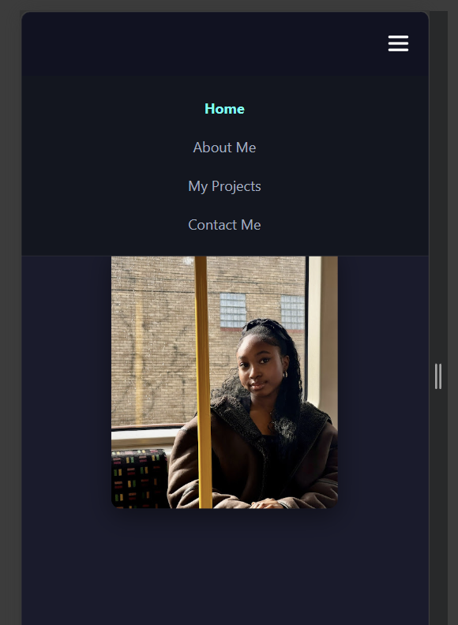

# Personal Online Portfolio

## 👤 About the Author & Developer
Welcome to my personal front-end development portfolio! 

Throughout my **Percipio learning journey**, I have completed an immense amount of rigorous coursework to build a strong foundation in modern web technologies. This portfolio is a living showcase of my technical skill set and my passion for creating beautiful digital experiences.

### 🚀 Technical Skills Acquired:
* **Core Markup & Layouts:** Semantic HTML5 & Responsive CSS3 architecture
* **Programming Logic:** Client-side JavaScript
* **Modern UI Frameworks:** React, JSX, and state management via Redux

### 🎨 My Creative Philosophy
I love leveraging CSS to transform clean code into beautiful layouts, deliberate typography, and engaging colour palettes. This portfolio directly reflects my creative flair, focusing heavily on building highly intuitive, responsive, and user-friendly web spaces.

---
## Features

## 🌟 Core Project Features

### 1. Responsive Hamburger Navigation Menu
* **Description:** Seamlessly collapses into a clean, touch-friendly hamburger drawer on mobile viewports using flexible CSS media queries to ensure smooth navigation across all devices.
* **Visual Preview:**

### 2. Image Gallery Asset Grid
* **Description:** Displays responsive project preview cards featuring sharp, accessible image ratios and clean hover transition micro-interactions that showcase my work cleanly.
* **Visual Preview:**

### 3. Accessible Contact Me Page
* **Description:** Features semantic HTML text input fields built with focus states, clear labels, and full form submission boundaries for clean user messaging.
* **Visual Preview:**

---
## Testing

## 🔍 Code Validation & Testing Documentation

As part of professional development practices, the application code was audited using the official **W3C HTML Validator** software to check for semantic syntax compliance and document outline structure warnings.

### Documented Syntax Resolution
* **Identified Warning:** The validator flagged a structural warning stating: *"This document has heading elements but none of them has a computed heading level of 1."* at line 27 where my `<h2>About Me</h2>` tag was placed.
* **Why it was an issue:** Skipping heading levels (starting a page with an `<h2>` instead of an `<h1>`) breaks web accessibility standards. Assistive technologies, like screen readers used by visually impaired users, rely on an `<h1>` element to instantly identify the primary purpose and main title of a webpage. Not adding this breaks the logical visual and programmatic hierarchy of the document.
* **The Resolution Fix:** I updated the structural HTML markup inside `about.html` by changing the opening and closing tags of the main content title from an `<h2>` to an `<h1>` tag (`<h1>About Me</h1>`). This establishes a proper level-1 document structure.

### 📸 Visual Step-by-Step Debugging Process

#### 1. Initial W3C Validation Scan (Warning Found)
The validator highlighted that the page was missing a main level-1 heading element.

#### 2. Locating the Problem in the Codebase
Looking at line 27 in my source files, the heading was structurally isolated inside an `<h2>` block.

#### 3. Applying the Semantic Structural Fix
I updated the source code tags from `<h2>` to `<h1>` to set a proper document root entry point.

#### 4. Final Verification Pass (Successful Clear)
Re-running the corrected markup file through the validator returned a completely pristine compliance score.

---
## Accessibility

## 🚀 Lighthouse Evaluation & Comprehensive Optimization

Google Lighthouse is an open-source, automated engineering auditing utility built into Google Chrome DevTools. It programmatically runs diagnostic stress-tests against a live deployment viewport across four foundational development categories: **Performance, Accessibility, Best Practices, and SEO**.

This section documents the step-by-step diagnostic journey of auditing the codebase, identifying accessibility and indexation bottlenecks, applying technical fixes, and achieving full optimization scores.

---

### 📊 Phase 1: Initial Baseline Audit Results

The initial system scan returned strong performance scores, but highlighted critical compliance gaps in the **Accessibility** and **SEO** metrics:
* **Performance (100/100):** Elite initial baseline rendering. 
* **Accessibility (85/100):** Flagged due to non-descriptive interactive controls and missing page architecture landmarks.
* **Best Practices (100/100):** Fully compliant with secure browser standards and modern web API schemas.
* **SEO (91/100):** Flagged due to missing meta-description variables needed by search index engine spiders.

#### Baseline Audit Proof (85 Accessibility & 91 SEO)

---

### 🔍 Phase 2: Diagnostic Analysis & Targeted Error Resolutions

Clicking directly into the sub-95 rating category logs revealed three critical development opportunities. Here is the engineering analysis of those warnings and how they were systematically corrected:

#### 1. Accessibility Error: "Buttons do not have an accessible name"
* **The Problem:** The mobile hamburger navigation bar toggle button relied on empty `` tags to draw the menu lines. Screen reader software used by visually impaired users could only announce "button," providing zero context.

* **The Solution:** Injected explicit `aria-label="Toggle navigation menu"` properties directly into the opening `<button>` tags across all HTML documents, giving the control a clear vocal identity for assistive devices.

#### 2. Accessibility Error: "Document does not have a main landmark"
* **The Problem:** While the secondary sub-pages used correct scaffolding, `index.html` lacked a primary structural root. The home landing split-hero elements sat loose inside the generic body array without a landmark this section did not include the "main" tags

* **The Solution:** Refactored the core semantic grid of `index.html` by wrapping the hero container division elements tightly inside an opening and closing `<main>` landmark tag block.

#### 3. SEO Error: "Document does not have a meta description"
* **The Problem:** The `<head>` elements of the markup files lacked a page description attribute, preventing search engines from generating summary text snippets under search query link returns.

* **The Solution:** Drafted and deployed a standardized, highly targeted descriptive meta asset tag (`<meta name="description" content="...">`) across the head blocks of all four project pages.

---

### 🏆 Phase 3: Final Verification Pass (The Perfect 100/100 Clean Sweep)

After saving the updated code files and clearing the browser cache layers, a final automated performance audit was executed. By resolving the semantic structural and meta-tag bugs, **the portfolio achieved perfect 100 marks across all four evaluation categories.**

#### Post-Optimization Verified Perfect Scores
The portfolio details absolute compliance, fast paint timelines, and perfect accessibility indexes.

#### Engine Loading Timelines & Speed Index Metrics
The performance metrics capture an initial content load footprint of just 0.8 seconds on a simulated mobile viewport with 0ms of interactive layout script blocking.

---

## 📁 Repository & Code Architecture
The architecture splits content delivery, aesthetics, and behavioral logic into predictable standalone structures:
* `index.html` - Welcome landing page entry gate.
* `about.html` - Biographical skill outline (includes custom semantic navigational nodes).
* `projects.html` - Directory mapping completed development milestones.
* `contact.html` - Direct client communication network channel.
* `style.css` - Custom styling stylesheet managing typography and global structural layout themes.
* `images/` - Asset folder holding performance-optimized graphics (e.g., `project.jpg`).

---

## 🛠️ How to View this Project Locally
1. Clone or download this repository folder to your local machine.
2. Open the directory path and double-click the `index.html` file to launch the application interface directly inside your default web browser.
